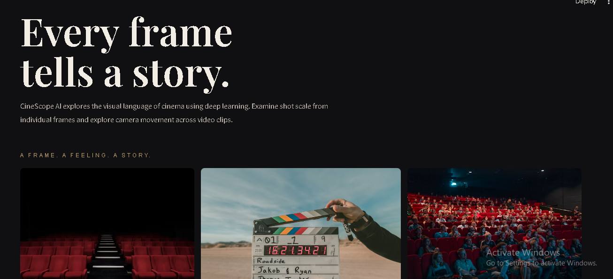
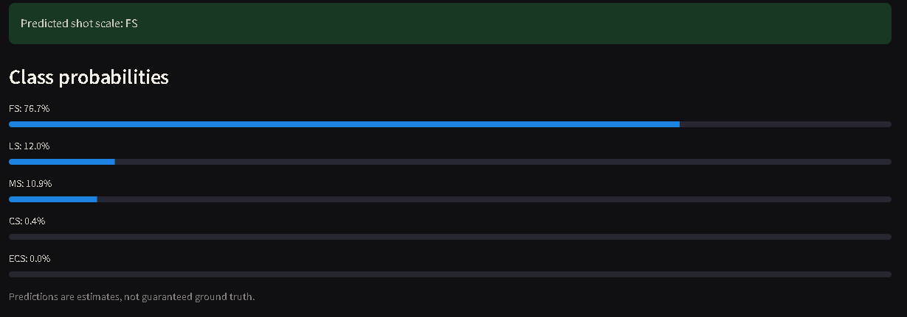
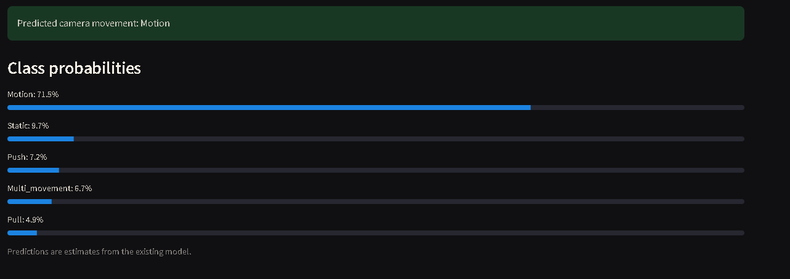

# Deep Learning-Based Cinematography Analysis

A deep learning project for automatic cinematography analysis using convolutional neural networks (CNNs), focusing on shot-scale classification and camera-movement classification using MovieShots-derived data.

## Project Overview

This project explores CNN-based approaches to understanding cinematography through two classification tasks:

- **Shot-Scale Classification:** Classifies frames into five shot-scale categories: `CS`, `ECS`, `FS`, `LS`, and `MS`.
- **Camera-Movement Classification:** Classifies camera movement using the original MovieShots labels: `Static`, `Motion`, `Push`, `Pull`, and `Multi_movement`.

The project includes an interactive Streamlit application for exploring predictions and experiments comparing baseline, augmented, and balanced-sampling CNN models.

## Project Pipeline

The project follows these main stages:

1. **Dataset Preparation:** Use MovieShots-derived annotations and prepare the data for the classification tasks.
2. **Preprocessing:** Extract and prepare frames for model training and evaluation.
3. **Model Training:** Train CNN models for shot-scale and camera-movement classification.
4. **Model Evaluation:** Compare experiments using test accuracy, macro F1-score, weighted F1-score, and per-class metrics where available.
5. **Interactive Exploration:** Use the Streamlit application to explore the project's classification features and predictions.

The project evaluates separate shot-scale and camera-movement models. Their results are assessed independently because they use different label sets and evaluation samples.


## Application Screenshots

### Home Page



### Shot-Scale Explorer



### Camera-Movement Explorer



## Project Structure

- `app/`: Streamlit application and supporting interface modules
- `scripts/`: Model training, evaluation, and experiment comparison scripts
- `src/`: Data preparation and frame extraction utilities
- `screenshots/`: Application screenshots
- `data/`: Local datasets, manifests, and generated artifacts, not included in this public repository
- `requirements.txt`: Python dependencies

## Installation and Usage

Clone the repository:

```bash
git clone https://github.com/ankitayyappan007/Deep_Learning_Cinematography.git
cd Deep_Learning_Cinematography
```

Install the dependencies:

```powershell
python -m pip install -r requirements.txt
```

Run the Streamlit application:

```powershell
python -m streamlit run app/streamlit_app.py
```

Open the local URL displayed in the terminal, usually `http://localhost:8501`.

**Note:** The dataset and trained model weights are not included in this public repository. Depending on the selected feature, the application may require the appropriate local data and model artifacts.


## Experimental Results

### Shot-Scale Classification

Two CNN experiments were evaluated on the same held-out test set of 500 images, with 100 images per class.

| Metric         |     Baseline CNN | Augmented CNN |
| -------------- | ---------------: | ------------: |
| Test accuracy  | **57.40%** |        51.60% |
| Macro F1-score | **57.63%** |        47.88% |
| Best epoch     |               10 |             5 |
| Training time  |    12.18 minutes |  5.64 minutes |

The baseline CNN achieved better test accuracy and macro F1-score than the augmented CNN. The augmentation experiment used horizontal flipping and small brightness and contrast variations, but these transformations did not improve the recorded test performance.

The baseline model is therefore the preferred model among these two experiments based on the saved evaluation results.

### Camera-Movement Classification

Both camera-movement experiments were evaluated on 1,682 test samples.

| Metric            |     Standard CNN | Balanced-Sampling CNN |
| ----------------- | ---------------: | --------------------: |
| Test accuracy     | **78.89%** |                27.23% |
| Macro F1-score    | **35.18%** |                18.16% |
| Weighted F1-score | **78.87%** |                37.84% |
| Test loss         |            0.842 |                 1.690 |

The standard model achieved substantially better overall results. However, the dataset is strongly imbalanced, and its high accuracy does not indicate equally strong performance across all classes.

The standard model achieved F1-scores of 86.37% for `Static` and 71.80% for `Motion`, but 17.74% for `Push` and 0% for both `Pull` and `Multi_movement`.

The balanced-sampling experiment improved recall for `Push` and `Pull`, but reduced overall accuracy and macro F1-score. Neither experiment correctly classified any `Multi_movement` test samples.

### Limitations

- The camera-movement test set contains 1,120 `Static` samples but only 8 `Multi_movement` samples.
- Overall accuracy can hide weak performance on minority classes.
- The balanced-sampling experiment did not provide a better overall result in the recorded comparison.
- The camera-movement labels are the original MovieShots labels. They are not mapped to specific movements such as pan, tilt, zoom, or tracking/dolly.
- The recorded results should be interpreted using both aggregate metrics and per-class evaluation.

### Results Interpretation

The baseline shot-scale CNN is the stronger of the two recorded shot-scale experiments. The standard camera-movement CNN is the stronger overall camera-movement experiment, although further work is needed to improve minority-class performance.
